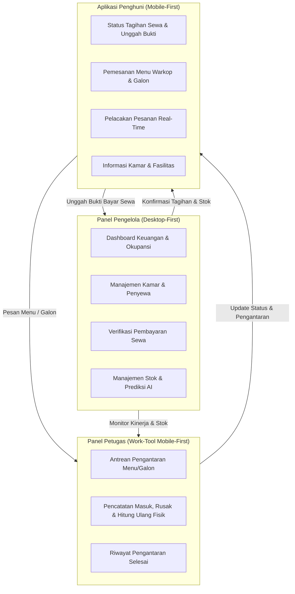
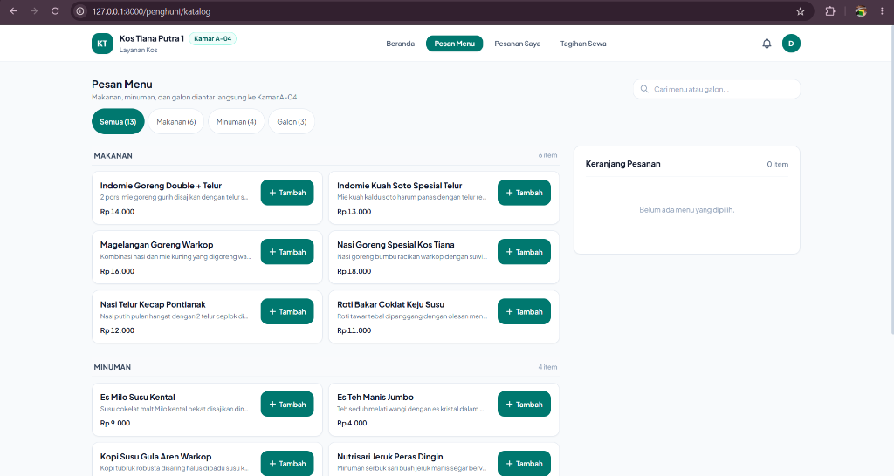
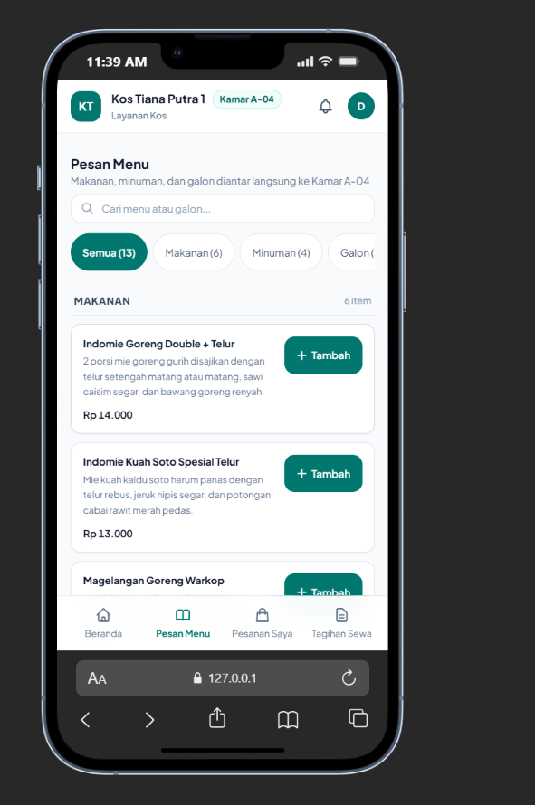
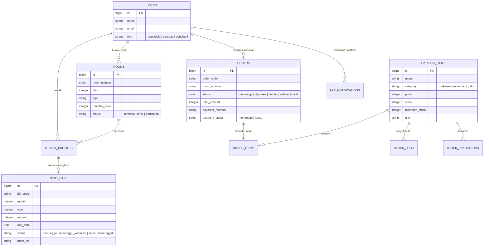

# Ringkasan Proyek Kos Tiana Putra

> Sistem Manajemen Operasional & Layanan Terpadu Kos-Kosan Berbasis Laravel 13, Tailwind CSS v4, dan Alpine.js

---

## 1. Ikhtisar Proyek

**Kos Tiana Putra** adalah platform aplikasi web modern yang dirancang khusus untuk mengelola operasional harian kos-kosan secara menyeluruh. Aplikasi ini menjembatani interaksi tiga peran utama—**Pengelola**, **Petugas Lapangan**, dan **Penghuni Kos**—dalam satu sistem terpadu yang andal, responsif, dan mudah digunakan.



---

## 2. Tech Stack & Fondasi Arsitektur

| Komponen | Teknologi | Penjelasan |
| :--- | :--- | :--- |
| **Framework Backend** | Laravel 13 (PHP 8.3+) | Routing terstruktur, controller modular per peran, Eloquent ORM, dan background queues. |
| **Styling & Token Desain** | Tailwind CSS v4 (`@theme`) | Token desain terpusat, responsif dari 320px hingga 1440px+, tipografi `Instrument Sans`. |
| **Frontend Reaktivitas** | Alpine.js v3 | State management ringan untuk keranjang pesanan (*cart*), kalkulasi perubahan stok, dialog modal, dan sinkronisasi data tanpa reload. |
| **Database** | SQLite / MySQL | Transaksi ACID dengan `lockForUpdate` pada manajemen inventaris untuk mencegah *race condition*. |
| **Komponen Antarmuka** | Blade Components | Komponen modular: `status-badge`, `price`, `order-stepper`, `qty-stepper`, `bottom-sheet`, `nota`. |

---

## 3. Fitur Utama Berdasarkan Peran

### A. Peran Pengelola (*Desktop-First Management*)
Panel administrasi terpusat untuk pemilik kos:
1. **Executive Dashboard:** Ringkasan pendapatan sewa, tingkat okupansi kamar, rasio pesanan warkop, dan grafik arus kas.
2. **Manajemen Kamar & Penghuni:** Inventaris kamar (lantai, fasilitas, harga sewa, status ketersediaan) dan riwayat profil penghuni lengkap dengan kontak darurat.
3. **Manajemen Tagihan Sewa:** Generate tagihan bulanan otomatis, tracking jatuh tempo, verifikasi bukti transfer manual, dan tanda lunas.
4. **Katalog & Stok:** Pengaturan harga jual menu warkop dan galon, penetapan batas minimum stok, dan audit mutasi barang.
5. **Prediksi Kebutuhan Stok:** Modul estimasi cerdas berbasis tren pemakaian bulanan untuk mencegah kehabisan air galon dan bahan konsumsi.

### B. Peran Petugas (*Work-Tool Mobile-First*)
Dirancang sebagai alat kerja operasional yang cepat dipindai satu tangan saat berjalan:
1. **Antrean Tugas:**
   - Pembaruan fragmen antrean otomatis setiap 30 detik (*auto-refresh* tanpa reload halaman).
   - Filter status dinamis (*Semua*, *Menunggu*, *Diproses*, *Diantar*) dan toggle khusus *Galon saja*.
   - Deteksi pesanan tertunda otomatis (peringatan merah jika pesanan melampaui batas toleransi 15/30 menit).
   - Tombol aksi utama tunggal selebar kartu (tinggi 48px): *"Mulai proses"*, *"Antar sekarang"*, dan *"Selesai, uang diterima"*.
2. **Stok Galon & Menu:**
   - Banner peringatan restock yang hanya muncul jika terdapat stok menipis atau habis.
   - 3 tombol aksi cepat per barang: **Masuk**, **Rusak**, dan **Hitung Fisik**.
   - Input opname fisik otomatis menghitung selisih positif/negatif dengan tinjauan langsung (*preview*) sebelum simpan.
   - Audit log mutasi di bagian bawah dengan penggabungan riwayat identik berulang menggunakan lencana kuantitas (`xN`).
3. **Riwayat Selesai:**
   - Filter satu baris ringkas (kata kunci kode pesanan/nomor kamar dan tanggal).
   - Pengelompokan riwayat per tanggal (*Hari ini*, *Kemarin*, atau tanggal lokal Indonesia).
   - Tampilan akordeon: baris tertutup ringkas, baris terbuka menampilkan rincian nota lengkap.

### C. Peran Penghuni (*Resident Mobile-First*)
Aplikasi harian penghuni kamar kos:
1. **Beranda:**
   - Status tagihan sewa kondisional: aksen merah saat menunggak, kuning saat verifikasi, tenang saat lunas.
   - Widget pelacakan pesanan aktif dengan stepper kemajuan.
   - Pintasan pemesanan ulang galon terakhir (*quick re-order*) dengan stepper jumlah dan tombol satu ketukan.
   - Informasi kamar dan lipatan fasilitas.
2. **Pesan Menu & Galon:**
   - Header kategori sticky (*Makanan*, *Minuman*, *Galon*).
   - Indikator stok cerdas (*Sisa sedikit* saat mendekati batas minimum, tombol *Habis* dinonaktifkan saat 0).
   - Tata letak adaptif: 2 kolom di layar lebar desktop, kartu ringkas di mobile.
   - Lembar *bottom-sheet* detail menu untuk membaca deskripsi lengkap, takaran satuan, dan penambahan cepat ke keranjang.
   - Keranjang pesanan sticky di bawah (mobile) dan panel samping (desktop).
3. **Pesanan Saya:**
   - Stepper status 4 tahap seragam: *Menunggu*, *Diproses*, *Diantar*, *Selesai*.
   - Dialog konfirmasi pembatalan untuk pesanan yang masih dalam tahap menunggu.
4. **Tagihan Sewa:**
   - Kartu tagihan bergaya nota dengan garis putus-putus dan ID mono.
   - Formulir unggah bukti transfer pembayaran dengan preview gambar sebelum dikirim.

---

## 4. Dokumentasi Tampilan Antarmuka

### A. Tampilan Desktop — Pesan Menu & Galon
Di layar desktop (lebar &ge; 1024px), antarmuka memanfaatkan ruang horizontal dengan pembagian 2 kolom:
- **Kolom Kiri:** Daftar menu makanan, minuman, dan galon dalam format grid 2 kolom dengan deskripsi produk yang informatif.
- **Kolom Kanan:** Panel ringkasan keranjang pesanan yang menempel (*sticky*) di sisi kanan, menampilkan item yang dipilih, rincian harga, total pembayaran, dan tombol konfirmasi pesanan.



### B. Tampilan Mobile — Pesan Menu Ringkas
Di layar smartphone (320px – 430px), antarmuka dioptimalkan agar tidak memakan ruang vertikal secara berlebihan:
- **Tinggi Kartu Ringkas:** Kartu menu memiliki tinggi terukur (~74px) dengan pembatasan teks deskripsi 1 baris di layar kecil, memungkinkan 4–5 menu terlihat sekaligus di layar.
- **Tombol Tambah Seimbang:** Tombol *+ Tambah* berada di posisi tengah vertikal kartu dengan tap target ergonomis (&ge; 44px).
- **Lembar Detail Bottom-Sheet:** Mengetuk kartu menu akan membuka lembar detail interaktif dari bawah untuk membaca deskripsi menu secara menyeluruh tanpa mengganggu daftar utama.



---

## 5. Struktur Data & Relasi Entitas



---

## 6. Standar Desain Sistem (Design Tokens)

Sistem warna aplikasi dibangun secara kustom (*bespoke*) menggunakan Tailwind CSS v4 `@theme` dengan hue netral condong ke *teal/ink*, menghapus seluruh ketergantungan pada palet bawaan Tailwind atau hex mentah. Seluruh warna memiliki rasio kontras WCAG AA (&ge; 4.5:1).

### Token Warna Inti (@theme)
- **Netral (Teal/Ink Undertone):**
  - `--color-canvas: #f2f4f1` — Latar belakang halaman aplikasi.
  - `--color-surface: #fafbf9` — Latar kartu, container, dan dialog modal (menghindari putih murni `#ffffff`).
  - `--color-line: #dbe1dc` — Border kartu, pemisah tabel, dan garis struktural.
  - `--color-ink: #16201e` — Teks utama & heading kontras tinggi.
  - `--color-ink-soft: #55645f` — Teks sekunder, label formulir, dan sub-informasi.
  - `--color-ink-faint: #8a9892` — Placeholder dan teks pendukung kecil.

- **Brand & Aksen Utama:**
  - `--color-brand: #006059` — Aksen utama brand, tombol tindakan utama (*primary actions*).
  - `--color-brand-deep: #004540` — State hover/active dan tahapan aksi final (*Selesai*).
  - `--color-brand-wash: #e1eeeb` — Background tipis indikator aktif, tab terpilih, dan chip badge.

- **Aksen Sekunder:**
  - `--color-ochre: #c98a2b` — Aksen kedua data chart (penjualan warkop) dan sorotan minor.
  - `--color-ochre-wash: #f6ead4` — Latar wash tipis aksen sekunder.

- **Status Semantik Tunggal:**
  - **Menunggu:** `--color-wait: #a86a0c` | Wash: `--color-wait-wash: #f8edd8`
  - **Diproses:** `--color-process: #3b5a8c` | Wash: `--color-process-wash: #e5ecf5` (biru tinta, jelas beda dari diantar)
  - **Diantar:** `--color-brand: #006059` | Wash: `--color-brand-wash: #e1eeeb` (teal operasional)
  - **Selesai / Lunas:** `--color-done: #4b7d57` | Wash: `--color-done-wash: #eaf1eb` (hijau sage kusam, bukan emerald terang)
  - **Tertunda / Menunggak / Habis / Batal:** `--color-alert: #b03a22` | Wash: `--color-alert-wash: #f8e8e4` (merah bata alami, bukan crimson/rose)

### Aturan Penerapan Desain
- **Status Badge:** Ditampilkan sebagai titik 6px berwarna + teks semantik berwarna, tanpa border keras atau pastel fill. Background wash hanya dipakai untuk status bernilai *alert* (Tertunda, Menunggak).
- **Hirarki Tombol Aksi:** Seluruh tombol aksi utama aplikasi seragam menggunakan `--color-brand` (termasuk *Bayar sekarang*, *Mulai proses*, *Antar sekarang*, dan *Verifikasi Lunas*). Tombol penyelesaian akhir menggunakan `--color-brand-deep`.
- **Tipografi & Angka:** Seluruh ID transaksi (`#ORD-...`, `#TAG-...`), NIK, dan jam menggunakan font **mono**. Seluruh angka nominal rupiah wajib memakai `whitespace-nowrap tabular-nums`.
- **Gaya Nota & Separator:** Rincian perhitungan pesanan dan tagihan dipisahkan dengan garis putus-putus (`border-dashed border-line`).
- **Bebas AI-Slop & Ornamen:** Tanpa emoji, tanpa chip pastel warna-warni sembarangan, tanpa gradasi pelangi, dan tanpa sudut melengkung berlebihan (radius 10-12px konsisten).

---

## 7. Panduan Menjalankan Aplikasi

### Kredensial Demo Cepat

Aplikasi dilengkapi *Quick Demo Role Switcher* pada halaman login maupun menu profil navbar untuk berpindah peran secara instan:

| Peran | Email | Kata Sandi | Halaman Utama |
| :--- | :--- | :--- | :--- |
| **Pengelola** | `pengelola@kostiana.com` | `password` | `/pengelola/dashboard` |
| **Petugas** | `petugas@kostiana.com` | `password` | `/petugas/dashboard` |
| **Penghuni** | `penghuni@kostiana.com` | `password` | `/penghuni/beranda` |

### Perintah Pengujian & Kompilasi

```bash
# Menjalankan pengujian otomatis PHPUnit / Pest
php artisan test

# Melakukan kompilasi aset frontend Tailwind & Alpine
npm run build

# Menjalankan server lokal pengembangan
php artisan serve
```
